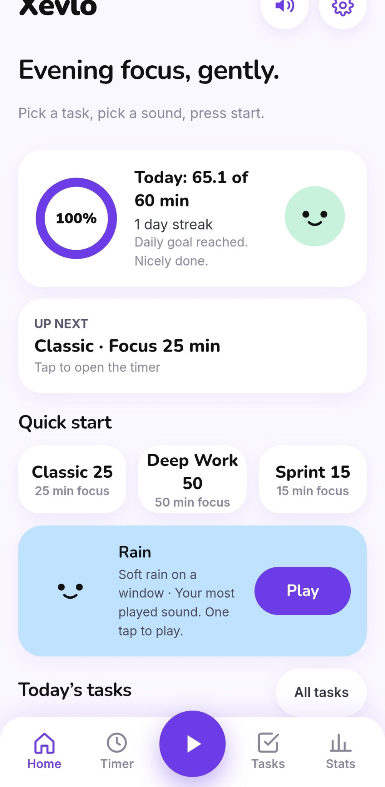

# Xevlo: Focus in short bursts, with sound

Xevlo is a pomodoro focus timer with ambient sounds, for working in short focused intervals with calming background sound. Pick a task, pick a sound, press start, and stay with one thing until the timer rings. No account, no ads, no internet needed.

## What it does

- Pomodoro timer on real timestamps: when a session starts, the app stores the exact end time, so the countdown stays correct after the app is closed or the phone sleeps and is reopened.
- Classic pomodoro cycle: Focus, Short Break, then Focus, and after the set number of focus sessions a Long Break, then the cycle restarts. The current phase is always shown with its cycle position, for example Focus 2 of 4.
- Session length presets, each editable: Classic (Focus 25, Short Break 5, Long Break 15, 4 focus sessions per cycle), Deep Work (Focus 50, Short Break 10, Long Break 30, 3 focus sessions per cycle), Sprint (Focus 15, Short Break 3, Long Break 10, 4 focus sessions per cycle). Custom presets too: focus 5 to 90 minutes, short break 1 to 30, long break 5 to 60, 2 to 6 focus sessions per cycle. Edit, duplicate or delete any preset. Deleted presets go to Trash with restore for 30 days.
- Controls: Start, Pause and Resume, Skip Phase (saves the minutes actually completed), Reset (with confirmation if a session is running), and End Session early (saves the minutes actually completed and stops the cycle).
- 10 ambient sounds, all synthesised in code with Web Audio, no sound files: Rain, Ocean Waves, Forest, Brown Noise, White Noise, Fan, Cafe Murmur, Fireplace, Night Crickets, Wind.
- Sound mixer: play up to 3 sounds at the same time, each with its own volume slider, for mixes like Rain plus Fireplace. Favourite sounds pin to the top, and sound presets are editable: Rainy Evening (Rain 80, Fireplace 40), Deep Focus (Brown Noise 70, Fan 30), Seaside Morning (Ocean Waves 80, Wind 30), Forest Study (Forest 70, Rain 30). Save the current mix as a new preset with one tap. Sounds can also play on their own, without a timer, with a sleep timer (Off, 15, 30, 45 or 60 minutes).
- Tasks: name, optional note, pastel colour, and an estimated number of pomodoros (1 to 12). Completing a focus session adds 1 to that task's completed pomodoros. Search by exact name, filter by Active, Done and All. Completed tasks move to a Done section and can be restored.
- History and stats: every completed focus session and break, newest first, grouped by Today and Earlier, with task, minutes, preset, sound or mix, and time. Current streak in days (a day counts when at least one focus session of 15 minutes or more is completed), total focus minutes, total focus sessions, total breaks taken, favourite ambient sound, a weekly bar chart of focus minutes per day for the last 7 days, and a monthly total. History is searchable, filterable and sortable.
- Daily goal: a target in focus minutes per day (default 60, about 2 to 3 classic pomodoros), with a progress ring on Home.
- Distraction log: during a focus session, log the moment with a timestamp and an optional one-line note, and the timer keeps running. Distractions are listed under each session in History, and Stats shows the total today and the average per focus session. The log is private, on device only, and every entry is deletable.
- Lavender, white and purple design with pastel cards and SVG blob mascots.
- Works fully offline. All data is stored only on the device, in local storage. No account, no server, no tracking.

## Honest limits

- Xevlo measures only minutes, sessions and distractions you log. It does not measure focus, attention or productivity, and it gives no focus score or productivity rating.
- Ambient sounds need the app open to keep playing. If the app is fully closed, sounds stop, because there is no server and no background audio service. The timer itself stays correct on reopen because of the stored end time, but no chime and no notification is guaranteed if the app is fully closed.
- The 3 sample tasks and 3 sample history entries included on first open are clearly marked as samples and are fully deletable. Streak and totals start from those samples only, and reset to true zero when the samples are deleted.

## Status

Working prototype, built November 2026. A signed Android APK also exists (Xevlo.apk, 107K, package com.yashdashrath.xevlo, versionCode 1, versionName 1.0, debug-signed, targetSdk 35, minSdk 24). Not phone-tested yet. No Play Store claim.

## Showcase only

This repository is a showcase. It contains no source code and no build files, and nothing here is open source. The screenshot(s) above are showcase images only. See NOTICE.md.

## Contact

Built by Yash Dashrath, Pune, India.

- Email: yashdashrath18@gmail.com
- LinkedIn: https://www.linkedin.com/in/yash-dashrath
- Yash MediaWorks: https://www.linkedin.com/company/yashmediaworks/
